# CortexAI - Multi-Agent AI Platform

CortexAI is a full-stack, multi-agent AI platform built on the MERN stack and orchestrated with LangGraph. It provides an intelligent workspace with specialized AI agents for conversational reasoning, real-time web search, full-stack code generation, document generation, image synthesis, and multimodal inspection.

---

## Features & Specialized Agents

* **Chat Agent:** General conversation, learning, and reasoning powered by Groq LPUs (`openai/gpt-oss-120b`).
* **Search Agent:** Live web search and current information retrieval powered by Groq and Tavily Search API.
* **Coding Agent:** Autonomous code generation, debugging, and software architecture design powered by OpenRouter (`deepseek/deepseek-chat`).
* **PDF Agent:** Automated structured PDF document creation using Groq and PDFKit, with private object storage in Supabase.
* **PPT Agent:** Automated presentation slide deck generation using Groq and PptxGenJS, stored securely in Supabase.
* **Vision Agent:** AI image generation using Pollinations AI (`black-forest-labs/flux.1-schnell` / `flux`) with prompt sanitization, server-side authorization, dynamic MIME validation, and Supabase presigned delivery.
* **Image Analyzer Agent:** Multimodal visual reasoning and image analysis powered by Google Gemini (`gemini-3.1-flash-lite`).
* **PDF RAG Agent (Deferred / Pending):** Document retrieval-augmented generation using `pdf-parse`, LangChain `RecursiveCharacterTextSplitter`, Google Gemini Embeddings (`gemini-embedding-001`), and Qdrant Cloud. *(Note: Document RAG analysis is deferred and pending production validation).*
* **Credit & Rate Limiting System:** Agent usage limits enforced via Upstash Redis and MongoDB, integrated with Razorpay payment processing (Test Mode).

---

## Deployment & Infrastructure

The application runs on a decoupled serverless and containerized free-cloud architecture.

### Frontend
* **Platform:** Vercel
* **Production URL:** [Vercel Production App](https://multi-agent-ai-platform-three.vercel.app)
* **GitHub Repository:** [MultiAgent-AI-Platform Repository](https://github.com/devv1002/MultiAgent-AI-Platform)
* **Deployment Branch:** `migration/free-cloud-deployment`

### Backend
* **Platform:** Render (Free Tier)
* **Service:** `cortexai-backend`
* **URL:** [Render Backend Service](https://cortexai-backend-ckao.onrender.com)
* **Health Endpoint:** [Render Health Check Endpoint](https://cortexai-backend-ckao.onrender.com/health)
* **Runtime:** Node.js 22 (`22.12.0`)
* **Deployment Branch:** `migration/free-cloud-deployment`

### Supporting Infrastructure
* **MongoDB Atlas:** Primary cloud database for user accounts, conversation history, and credit records.
* **Upstash Redis:** Cloud Redis instance for distributed session management, message caching, and agent rate limits.
* **Firebase Authentication:** Google OAuth identity provider and client token issuance verified server-side with Firebase Admin SDK.
* **Supabase Storage:** Private object storage bucket (`cortexai-files`) providing short-lived presigned URLs (900 seconds) for generated PDFs, PPTs, and images.
* **Qdrant Cloud:** Managed vector database configured for text chunk embeddings *(currently deferred / pending)*.
* **Razorpay:** Payment gateway integration for credit top-ups *(currently running in Test Mode)*.

### Deployment Architecture

```mermaid
flowchart TD
    User["User Browser"] -->|"HTTPS / Client UI"| Vercel["Vercel (React Frontend)"]
    Vercel -->|"Edge Rewrites (/api/*)"| Render["Render (Express Backend - Node.js 22)"]

    subgraph Operational ["Operational Services"]
        Mongo[("MongoDB Atlas\n(Accounts & Chat History)")]
        Redis[("Upstash Redis\n(Sessions & Rate Limits)")]
        Firebase["Firebase Auth\n(Identity & Token Verification)"]
        Supabase["Supabase Storage\n(PDF, PPT, Vision Artifacts)"]
        AI["AI Inference Providers\n(Groq / Gemini / OpenRouter / Pollinations / Tavily)"]
        Razorpay["Razorpay Gateway\n(Test Mode Only)"]
    end

    subgraph Deferred ["Deferred Functionality (Pending)"]
        Qdrant[("Qdrant Cloud\n(Vector Embeddings - PDF RAG)")]
    end

    Render --> Mongo
    Render --> Redis
    Render --> Firebase
    Render --> Supabase
    Render --> AI
    Render --> Razorpay
    Render -.->|"Pending RAG Pipeline"| Qdrant

    style Deferred stroke-dasharray: 5 5,stroke:#f59e0b,fill:#1e1b18
    style Qdrant stroke-dasharray: 5 5,stroke:#f59e0b
```



### Deployment Notes
* **Render Free-Tier Spin-Down:** The backend service on Render may spin down after periods of inactivity. Incoming requests can experience a 45–60 second cold-start delay while the instance spins up.
* **Request Routing:** Vercel edge rewrites in `frontend/vercel.json` forward all `/api/*` calls directly to the Render backend (`https://cortexai-backend-ckao.onrender.com/api/:path*`), preserving HTTP cookies and credentials.
* **Environment Configuration:** All API credentials, database URIs, and provider keys must be supplied exclusively through host platform environment variables (Render Environment settings and Vercel Project Settings).
* **Security & Secrets:** Never commit `.env` files, service account JSON files, or live secrets to Git.
* **Payment Status:** Razorpay is configured strictly in Test Mode (`rzp_test_*`). Live payment processing has not been verified.
* **PDF RAG Status:** PDF document RAG analysis is deferred and pending production verification.

---

## Tech Stack

* **Frontend:** React 19, Vite, Tailwind CSS v4, Redux Toolkit, Lucide React, Motion.
* **Backend:** Node.js 22, Express 5, LangChain / LangGraph, Multer, Mongoose 9, ioredis.
* **AI & Orchestration:**
  * LangGraph StateGraph workflow engine
  * Groq (`openai/gpt-oss-120b`)
  * Google Gemini (`gemini-3.1-flash-lite`, `gemini-embedding-001`)
  * OpenRouter (`deepseek/deepseek-chat`)
  * Pollinations AI (`flux`)
  * Tavily Search API

---

## Local Development Setup

### Prerequisites
* Node.js 22.x (refer to `.node-version`)
* npm 10+
* MongoDB Atlas cluster or local MongoDB instance
* Upstash Redis database or local Redis server

### 1. Clone Repository
```bash
git clone https://github.com/devv1002/MultiAgent-AI-Platform.git
cd MultiAgent-AI-Platform
git checkout migration/free-cloud-deployment
```

### 2. Backend Setup
```bash
cd backend
npm install
```

Create a `.env` file in `backend/` based on `backend/.env.example`:
```env
PORT=8000
NODE_ENV=development
FRONTEND_URL=http://localhost:5173

# Database & Cache
MONGODB_URI=your_mongodb_connection_string
REDIS_URL=your_redis_connection_url

# Security & Internal Service Auth
INTERNAL_SERVICE_KEY=your_internal_service_key_min_32_chars

# Firebase Admin SDK (Authentication)
# Option A: Single-line stringified JSON from Firebase Console (Project Settings > Service Accounts)
# Option B: Place downloaded serviceAccountKey.json at backend/services/auth/serviceAccountKey.json
FIREBASE_SERVICE_ACCOUNT_JSON=<single-line-stringified-firebase-service-account-json>

# Payment Gateway (Test Mode Only)
RAZORPAY_KEY_ID=your_razorpay_test_key_id
RAZORPAY_KEY_SECRET=your_razorpay_test_key_secret

# AI Providers
GROQ_API_KEY=your_groq_api_key
GOOGLE_API_KEY=your_google_gemini_api_key
OPENROUTER_API_KEY=your_openrouter_api_key
TAVILY_API_KEY=your_tavily_api_key
POLLINATIONS_API_KEY=your_pollinations_api_key

# Vector Database (PDF RAG - Deferred / Pending)
QDRANT_URL=your_qdrant_cluster_url
QDRANT_API_KEY=your_qdrant_api_key

# Supabase Storage (Object Storage for PDF, PPT & Images)
SUPABASE_URL=your_supabase_project_url
SUPABASE_SERVICE_ROLE_KEY=your_supabase_service_role_key
SUPABASE_BUCKET_NAME=cortexai-files
```

Start the backend server (runs `nodemon server.js`):
```bash
npm run dev
```

### 3. Frontend Setup
In a separate terminal window:
```bash
cd frontend
npm install
```

Create a `frontend/.env.local` file:
```env
# In local development: set to backend server URL; in production on Vercel: leave empty to use vercel.json rewrites
VITE_SERVER_URL=http://localhost:8000

# Firebase Web Client API Key (from Firebase Console > Project Settings > General > Web Apps)
VITE_FIREBASE_API_KEY=your_firebase_web_api_key

# Razorpay Client Key ID (Test Mode Only)
VITE_RAZORPAY_KEY_ID=your_razorpay_test_key_id
```

Start the frontend development server (runs `vite`):
```bash
npm run dev
```

The frontend will be accessible at:
```text
http://localhost:5173
```
